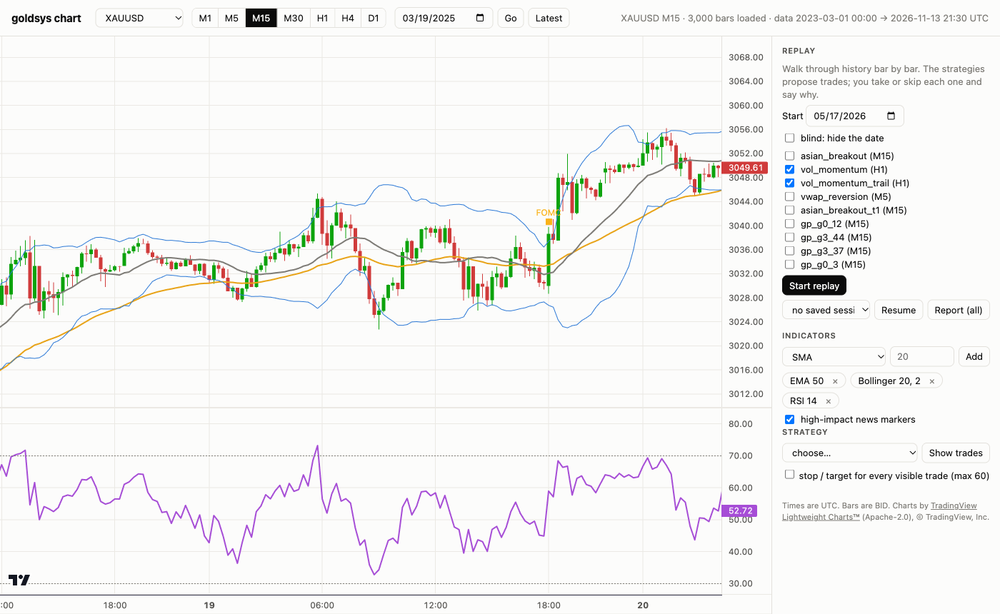
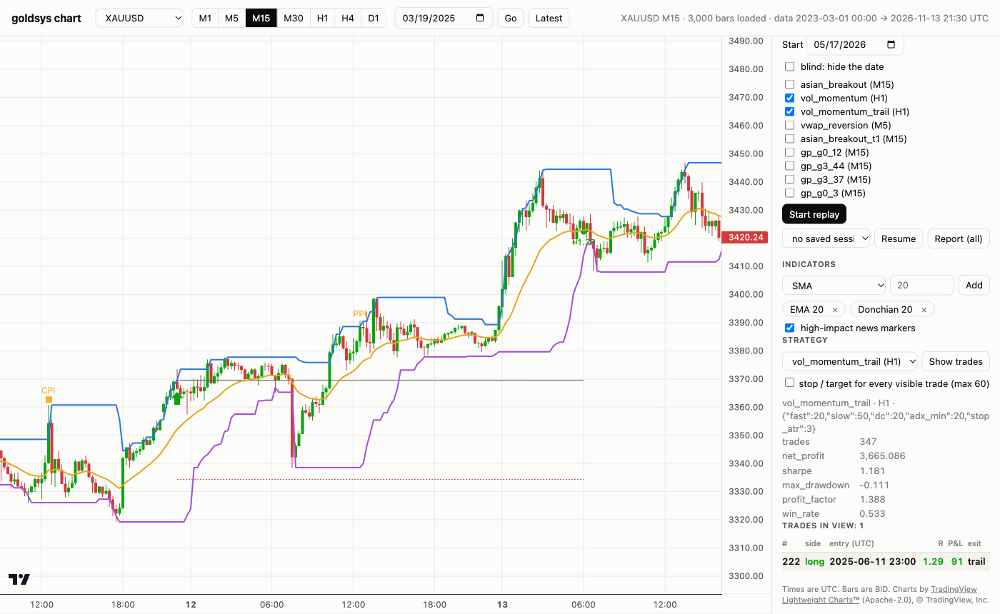
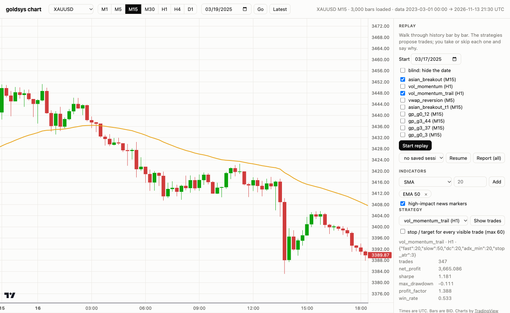
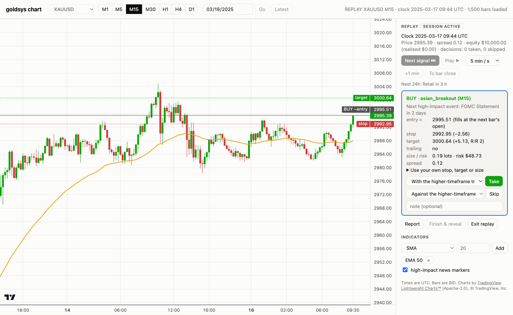
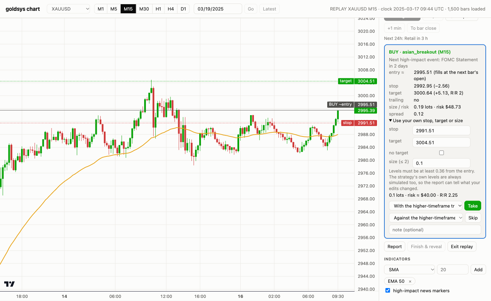
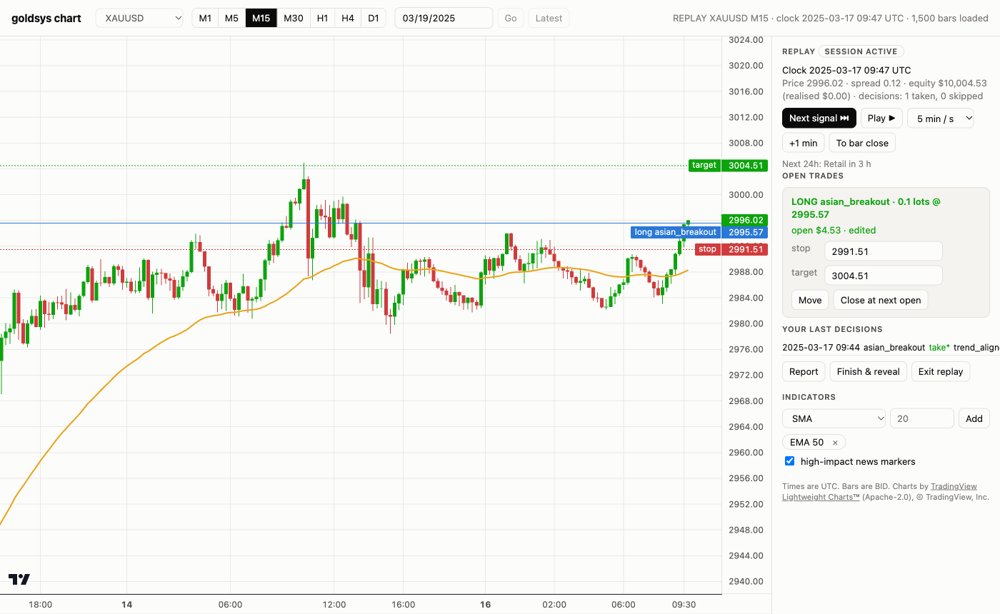
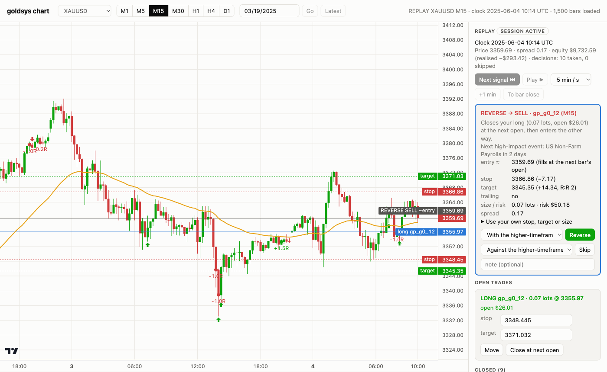
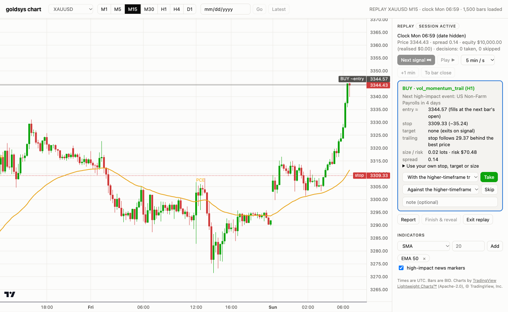
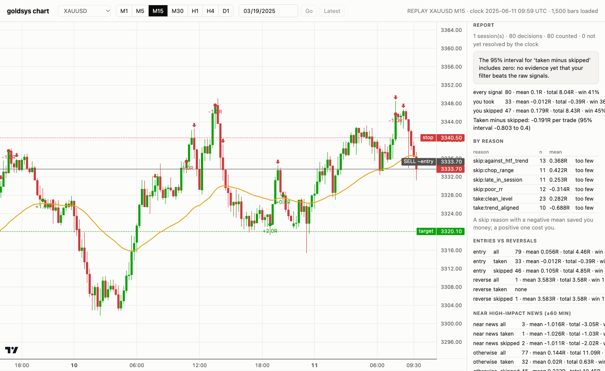
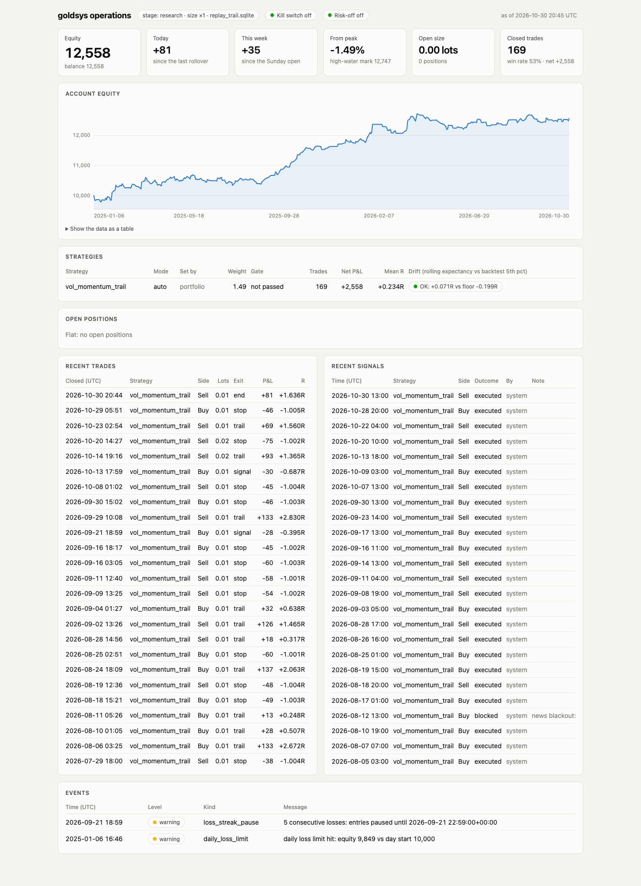

# goldsys: a simple tutorial

goldsys is a workbench for trading gold (XAUUSD). It does four things:

1. **Shows you the chart** like TradingView: scroll back in time, switch timeframes, add indicators.
2. **Tests strategies** on your real price history and shows every trade on the chart.
3. **Lets you play it back as a "hybrid" trader**: the system proposes trades bar by bar, *you* decide take or skip, and it later tells you whether your decisions beat the raw signals.
4. **Can run strategies live** (paper first, then a broker demo account), with risk limits and a kill switch.

> **Read this first.** Nothing in here has been shown to make money. The strategies that ship with it mostly lose on your real data, and the one that looks good (`vol_momentum`) was tested over a period when gold nearly doubled. Use this to *find out* whether you have an edge, not to assume you do. Never go near real money before weeks of demo trading.

Everything below runs on your own computer. Commands are typed in a terminal inside the project folder (`mygoldbot`).

---

## 1. One-time setup

```bash
cd mygoldbot
source .venv/bin/activate          # turn on the project's Python
python -m pytest -q                # optional: should end with "passed"
```

If `.venv` does not exist yet: `uv venv .venv --python 3.13 && source .venv/bin/activate && uv pip install -e ".[dev,llm]"`.

## 2. Get price data (once)

The system needs **1-minute gold bars**. You already imported yours from MetaTrader 5. To do it again, or for a new file:

1. In MT5: **View > Symbols > Bars**, pick `XAUUSD`, timeframe **1 Minute**, set an early start date, click **Request**, then **Export Bars**. You get a `.csv`.
2. Check it without changing anything:
   ```bash
   python scripts/import_mt5.py ~/Documents/XAUUSD_M1_....csv --check
   ```
   It prints the date range, the broker's clock (it works this out by itself) and the typical spread.
3. Import it:
   ```bash
   python scripts/import_mt5.py ~/Documents/XAUUSD_M1_....csv --source-name "Deriv MT5"
   ```

Your data now lives in `data/bars/XAUUSD/`. Re-running the import with the same file is safe. A symbol only ever holds one data source, so you cannot accidentally mix two brokers' prices.

> The built-in `XAUUSD_SYN` symbol is **fake** random data for testing. Anything you see on it means nothing. The chart warns you when you are on it.

## 3. Start the app

```bash
python scripts/chart.py
```

Open **http://127.0.0.1:8787/chart** in your browser (the screenshots below use port 8791; yours is 8787 unless you pass `--port`). Leave the terminal window open while you use it; press `Ctrl-C` to stop.

---

## 4. The chart



What you are looking at:

| Where | What it does |
|---|---|
| **Top left** | Pick the symbol and the timeframe (M1 to D1). |
| **Date box + Go** | Jump to any day (UTC). **Latest** jumps back to now. |
| **Drag the chart** | Scroll through history. Older bars load automatically as you go left. |
| **Indicators (right)** | Pick one (SMA, EMA, Bollinger, Donchian, VWAP, Asian range, sessions, RSI, ATR, ADX, MACD), type its numbers if you want different ones (for example `20, 2` for Bollinger), click **Add**. Click the **x** on a chip to remove it. RSI/ATR/ADX/MACD get their own panel under the price. |
| **Orange squares** | High-impact news (here **FOMC** at 18:00 UTC on 19 March 2025). Tick or untick "high-impact news markers" to hide them. |
| **Hover** | The top-left legend shows open, high, low, close, spread and every indicator value at that bar. |

All times are **UTC**. Prices are the **bid**.

---

## 5. See what a strategy does

A *strategy* is a small text file in `strategies/` (for example `vol_momentum.yaml`). It says when to enter, where the stop and target go, and how big to trade. You do not need to program.

In the right panel, under **Strategy**, choose one and click **Show trades**:



- Every trade gets an **arrow** (entry) and a **circle with the result in R** (R = profit divided by the money risked; +1.3R means it made 1.3 times what it risked).
- Click a trade in the list to jump to it: you see its **entry line** (grey) and **stop** (red dashed).
- The panel shows the backtest numbers: trades, net profit, Sharpe, max drawdown, profit factor, win rate.
- The strategy's own indicators (here the 20 EMA and Donchian channel) are added for you.

> Backtest numbers are *in-sample*: they describe the past the strategy was built on. A good number is a reason to test further, not a reason to trade.

---

## 6. The hybrid replay (the main event)

This is the part that answers *"do my decisions add anything?"*. The system walks through history one minute at a time. When a strategy fires, it **stops and asks you**. You look at the chart, decide, and say why. It never shows you the future.

### 6.1 Start a session



1. Pick a **Start** date. Choose a stretch you have *not* memorised.
2. Tick one or more **strategies** (they will propose trades).
3. Optional: **blind** hides the date (see 6.7).
4. Click **Start replay**.

The chart jumps to that date and shows only history up to it. Click **Next signal** to run the clock until a strategy proposes a trade.

### 6.2 A proposal



The clock stopped and drew the trade on the chart: **BUY ~entry**, **stop** (red) and **target** (green). The card on the right says:

- **What and when**: "BUY asian_breakout (M15)".
- **News**: "Next high-impact event: FOMC Statement in 2 days." It turns red with a warning if an event is within an hour. The line under the buttons shows the next 24 hours of scheduled events.
- **Entry, stop, target, size, risk** in dollars. The trade will fill at the **next bar's open**, like in real life.
- **Trailing**: whether the stop follows the price (see section 8).

**You must answer before the clock moves again:**

- Pick a **reason** from the list and click **Take**, or pick a reason and click **Skip**. Reasons are fixed on purpose (for example *With the higher-timeframe trend*, *Against the trend*, *News risk*, *Weak level*, *Gut feel*). A note is optional.
- Why make you pick a reason? Because the report later tells you **which of your reasons actually predicted anything**. A reason you cannot name is a gut feeling, and the data will tell you if gut feel works.

### 6.3 Use your own stop, target or size

Open **Use your own stop, target or size** on the card:



Type a price in **stop** and/or **target** (or tick **no target**) and a **size** in lots. The red and green lines on the chart move as you type, and the risk line updates. Click **Take** and your version is traded. If a level is too close to the entry or on the wrong side, it is refused with a message.

The strategy's own version of the trade is **always simulated too**, silently. That is how the report can tell "my filter was good" from "my stop placement was good".

### 6.4 Manage a trade that is open



An open trade shows its entry, current **stop** and **target**, and the open profit. You can:

- change the **stop** and/or **target** and click **Move** (it applies from the next bar; clearing the target field removes the target),
- **Close at next open**.

Moving the stop by hand switches off any automatic trailing stop: you are in charge now. The chart marks entries (arrows) and exits (circles with R).

### 6.5 Reversals



If a strategy that is **already in your trade** signals the **opposite way**, you are offered a **reversal**: close the old trade at the next open and enter the other way, which is what the backtester would do. Click **Reverse** or **Skip** (skip = keep the old trade). Same-direction signals while you are in a trade are simply not shown.

### 6.6 The controls

| Button | What it does |
|---|---|
| **Next signal** | Run until a strategy proposes something. |
| **Play** + speed | Let the clock run by itself (1 minute per second up to 4 hours per second). It stops at a proposal. |
| **+1 min** | One minute forward. |
| **To bar close** | Forward to the end of the current chart bar (use it to watch a bar form). |
| **Report** | Score your decisions so far (6.8). |
| **Finish & reveal** | End the session and count everything (asks twice). |
| **Exit replay** | Back to the normal chart. Your session is saved: use **Resume** later. |

You can switch timeframe and add indicators during a replay. The newest bar is the *partial* bar the clock is inside, exactly like a live chart.

### 6.7 Blind mode



Tick **blind** and the date disappears: the clock reads "Mon 06:59" and the axis shows only weekday and time. Dates are secretly shifted by whole weeks, so weekday and time of day stay real. This stops you recognising "that's the March 2025 rally" and deciding with hindsight. (Price levels can still hint at the year, so choose a start you do not remember.)

### 6.8 Read the report

Click **Report** (current session) or **Report (all)** (every session):



Read it top to bottom:

1. **The yellow note.** Here: the interval for "taken minus skipped" includes zero, so there is *no evidence yet* that your filtering beats the raw signals. With fewer than 30 decisions in a group the report refuses to draw conclusions. Believe it.
2. **every signal / you took / you skipped.** Average R and total R of everything the strategies proposed, of what you took, and of what you skipped. If you took better trades than you skipped, "taken minus skipped" is positive and its interval is above zero.
3. **By reason.** Each reason you used and how those trades turned out. A **skip** reason with a *negative* average **saved you money**. A skip reason with a *positive* average **cost you money**. A reason marked "too few" has not had enough use to mean anything.
4. **Entries vs reversals**, **your levels, size and management** (did your own stops help?) and **near high-impact news** (do the trades around FOMC/CPI do worse?).

The report only counts outcomes the clock has already passed, so it cannot leak the future into your next decision. **Finish & reveal** counts everything.

### 6.9 Habits that make the answer trustworthy

- Make **at least 30 decisions** of each kind before believing anything, preferably 100+.
- Use **blind mode** and starting dates you do not remember.
- Always give an honest reason. "Gut feel" is a valid answer; making up a nice reason is not.
- Do not keep re-running the same stretch of history until it looks good. That is fooling yourself with extra steps.
- If the report says no evidence, the honest conclusion is "no evidence yet". That is useful information.

---

## 7. The news calendar

The chart markers, the replay's news warnings and the live "news blackout" all read one file, `data/calendar/events.csv`. It holds only **when** each release happens, never the numbers.

```bash
python scripts/import_calendar.py --fomc     # Fed meetings 2021 to 2027 (no key needed)
python scripts/import_calendar.py --fred     # jobs report, CPI, PPI, PCE, GDP, retail sales (needs a free FRED key)
python scripts/import_calendar.py --fred --check   # preview without writing
```

Put your key in a file named `.env` in the project folder: `FRED_API_KEY=your32characterkey`. (`.env` is ignored by git.) Run `--fred` every few months to pick up newly published dates. The importer prints how many events it has per year, and warns if a type of event is missing, so a gap is visible instead of silent.

## 8. Strategies, and how to change one

Open `strategies/vol_momentum_trail.yaml` in any text editor. The important parts:

```yaml
name: vol_momentum_trail
timeframe: H1                       # the strategy looks at 1-hour bars
entry_long:  ...                    # when to buy (EMAs, ADX, breakout...)
entry_short: mirror                 # sell on the mirror-image condition
exit:
  stop:  {atr_mult: 3.0, atr_n: 14}                            # stop 3 x ATR away
  trail: {atr_mult: 2.5, atr_n: 14, activate_r: 1.0}           # trailing stop: follow price 2.5 ATR behind, once 1R in profit
  max_bars: 400
sizing: {type: vol_target, annual_vol: 0.10, equity: 10000}    # size to a steady risk level
params: {fast: 20, slow: 50, dc: 20, adx_min: 20, stop_atr: 3.0}
```

- Edit a number, save, and click **Show trades** again to see the effect. (Run `python scripts/run_backtest.py strategies/vol_momentum_trail.yaml --symbol XAUUSD` for the numbers in the terminal.)
- A **trailing stop** moves only in your favour, and only from the bar *after* each new best price. It works in the backtest, the replay and live trading.
- Copy a file to make a new strategy. Put experiments in `strategies/candidates/`.

> Careful: the more you tweak numbers to make the backtest look good, the more you are fitting the past. That is what the next section is for.

## 9. Research commands

```bash
# one backtest, with trades
python scripts/run_backtest.py strategies/asian_breakout.yaml --symbol XAUUSD

# the full validation gate: walk-forward, overfitting checks, Monte Carlo, cost stress.
# It writes a pass/fail report to reports/. Use --quick for a fast pass.
python scripts/run_gate.py strategies/vol_momentum.yaml --symbol XAUUSD

# let the computer look for strategies (results go to strategies/candidates/)
python scripts/run_search.py tier1 strategies/asian_breakout.yaml --symbol XAUUSD --trials 100   # tune numbers
python scripts/run_search.py tier2 --symbol XAUUSD --generations 10 --pop 30                      # evolve rules
```

The **gate** is the honest referee: it asks whether a strategy still works on data it was not tuned on, after realistic costs, and how many things you tried before finding it. A strategy that fails the gate should not be traded. (The gate has not been run on your real data yet, so no strategy here has earned a pass.)

## 10. Going live (later, carefully)

The ladder is **research → demo → tiny live → live**, and each step is guarded:

1. Build a portfolio file from strategies: `python scripts/portfolio.py build strategies/vol_momentum_trail.yaml --symbol XAUUSD --allow-unvalidated --mode auto` (`--mode approve` makes every trade wait for your approval; `--allow-unvalidated` is for practice only).
2. Replay it through the live machinery on history: `python scripts/run_live.py replay --symbol XAUUSD --start 2025-01-06 --fresh`.
3. Watch it in the operations dashboard: `python scripts/dashboard.py --db live_replay.sqlite --port 8788` and open `http://127.0.0.1:8788` (a different port from the chart so both can run together).



The dashboard shows equity, open positions (with the **stop now** next to the stop set at entry, so you can see a trailing stop move), recent trades and exits (`trail` = stopped out by the trailing stop), every signal and what happened to it, and alerts. In the panel you can approve or veto waiting trades, set a strategy to auto/approve/off, switch on **risk-off**, or pull the **kill switch** (closes everything, blocks new trades).

Built-in protection: daily and weekly loss limits, a loss-streak pause, news blackouts (now fed by your calendar), a spread guard, position and size caps, and an automatic kill switch on stale data or a disconnected broker. A strategy whose recent results fall below its own backtest's worst-case range is switched off automatically.

Real broker (MetaTrader 5, Windows only): this has **never been run against a real terminal**. Start with `python scripts/mt5_bridge_server.py --selftest` on a **demo** account, which opens a tiny position, moves its stop, and closes it. Real money needs strategies that passed the gate, at least 8 weeks of demo that reconcile with the backtest, and two explicit confirmations. Do not skip these.

---

## Cheat sheet

| I want to... | Do this |
|---|---|
| Open the chart and replay | `python scripts/chart.py`, then open `/chart` |
| Import MT5 history | `python scripts/import_mt5.py FILE.csv --check`, then without `--check` |
| Refresh the news calendar | `python scripts/import_calendar.py --fomc` and `--fred` |
| Backtest a strategy | `python scripts/run_backtest.py strategies/NAME.yaml --symbol XAUUSD` |
| Validate it properly | `python scripts/run_gate.py strategies/NAME.yaml --symbol XAUUSD` |
| Score my replay decisions | **Report** button, or `python scripts/replay_report.py` |
| Resume a replay | **Resume** dropdown in the Replay panel |
| Run the tests | `python -m pytest -q` |

## Where things are saved

| Path | What |
|---|---|
| `data/bars/XAUUSD/` | Your imported price history |
| `data/calendar/events.csv` | The news schedule |
| `strategies/` | Strategy files you can edit |
| `replay.sqlite` | Every replay session: each proposal, your decision, your reason, and the shadow outcome |
| `reports/` | Gate reports, imports, portfolio summaries |
| `live*.sqlite` | The live/paper ledger (tamper-evident) |
| `.env` | Your keys (never committed) |

## When something looks wrong

- **"No bar data found"**: import data first (section 2).
- **A yellow "Synthetic data" banner**: you are on the fake `XAUUSD_SYN` data. Switch the symbol to `XAUUSD`.
- **No news markers**: run `import_calendar.py` (section 7). The replay panel says "No news calendar loaded" when it is empty.
- **"decide the pending proposal first"**: the clock will not move past an undecided proposal. Take or skip it.
- **The page looks empty for a second**: it is loading history; wait a moment.
- **Port already in use**: `python scripts/chart.py --port 8790`.
- **Anything else**: run `python -m pytest -q`. If tests pass, the code is fine and the problem is usually data or a typo in a strategy file.
